
<main id="stage" aria-label="MATH421 Midterm Presentation">
<section class="slide cover" aria-label="Rhode Island hospital discharges" data-slide="1"><h2>Rhode Island hospital discharges</h2>
MATH 421 Midterm

I studied hospital stays that ended in 2018. I looked at the charts first, then compared models for hospital charges and longer stays.

1 / 22
</section>
<section class="slide" aria-label="The data" data-slide="2"><h2>The data</h2>

My data comes from the Rhode Island Department of Health. I used 131,478 hospital discharge records from 2018.

A record represents a hospital stay. The same person could appear more than once.

I removed four columns with missing values. The charts use the full 2018 group.

2 / 22
</section>
<section class="slide with-plot" aria-label="Admissions by month" data-slide="3"><h2>Admissions by month</h2>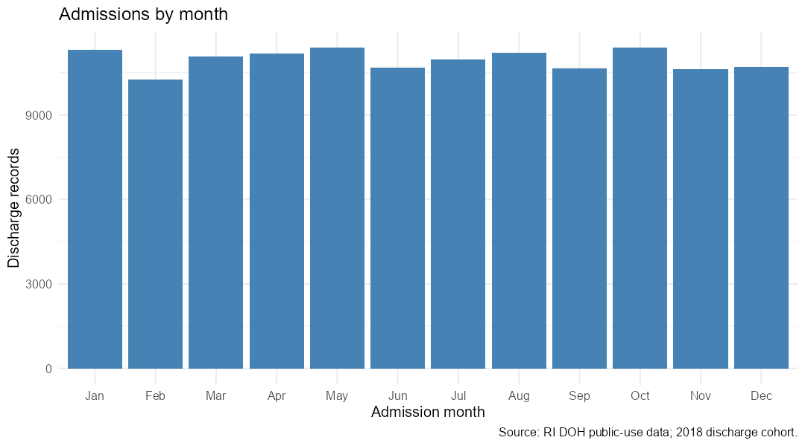

October had the most records, with 11,408. February had the fewest, with 10,259. These counts group the 2018 discharge records by admission month. They do not adjust for the number of days in each month.

3 / 22
</section>
<section class="slide with-plot" aria-label="Admissions by sex" data-slide="4"><h2>Admissions by sex</h2>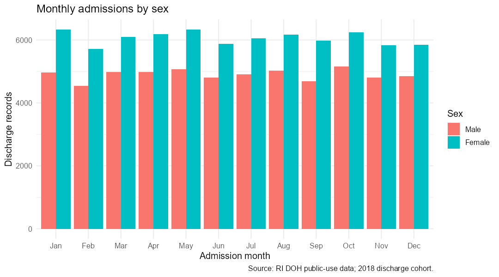

There were 72,675 female records and 58,799 male records. Four records had an unknown sex code. The chart shows more female than male records in every admission month. These are hospital counts, not population rates.

4 / 22
</section>
<section class="slide with-plot" aria-label="Age at admission" data-slide="5"><h2>Age at admission</h2>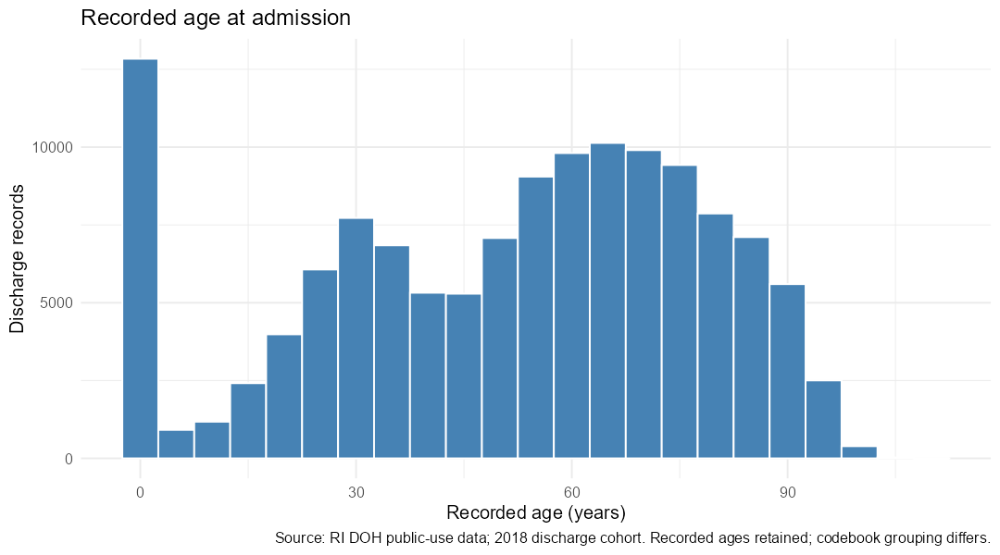

The median recorded age was 56. The large group near age zero includes newborn hospital care. The data also includes many older adults. This shows that the hospitals serve very different age groups.

5 / 22
</section>
<section class="slide with-plot" aria-label="Age by sex" data-slide="6"><h2>Age by sex</h2>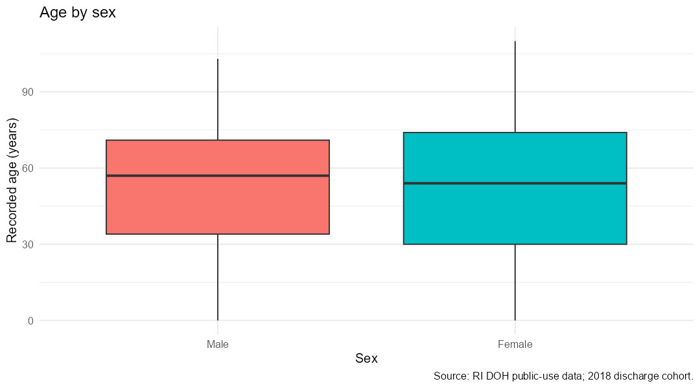

Female records were about 0.63 years younger than male records on average. The difference was small. The boxes show a wide range of ages in both groups. Differences in the types of care may help explain the pattern.

6 / 22
</section>
<section class="slide with-plot" aria-label="Records by hospital" data-slide="7"><h2>Records by hospital</h2>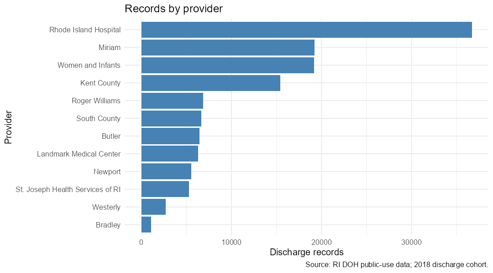

Rhode Island Hospital had the most records, with 36,693. Miriam and Women and Infants followed. Hospital volume matters when comparing total charges. A hospital with more stays can have higher total charges even without higher charges per stay.

7 / 22
</section>
<section class="slide with-plot" aria-label="The distribution of charges" data-slide="8"><h2>The distribution of charges</h2>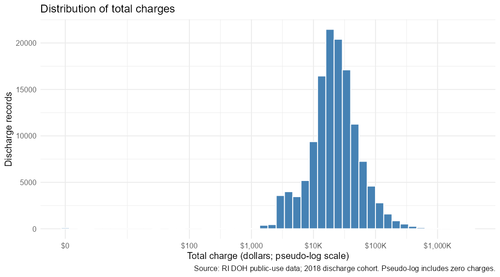

The median total charge was $21,854. The mean was about $34,317. The higher mean shows the influence of very expensive stays. The dollar axis uses uneven spacing so a wide range of charges can fit on the chart.

8 / 22
</section>
<section class="slide with-plot" aria-label="Charges by hospital" data-slide="9"><h2>Charges by hospital</h2>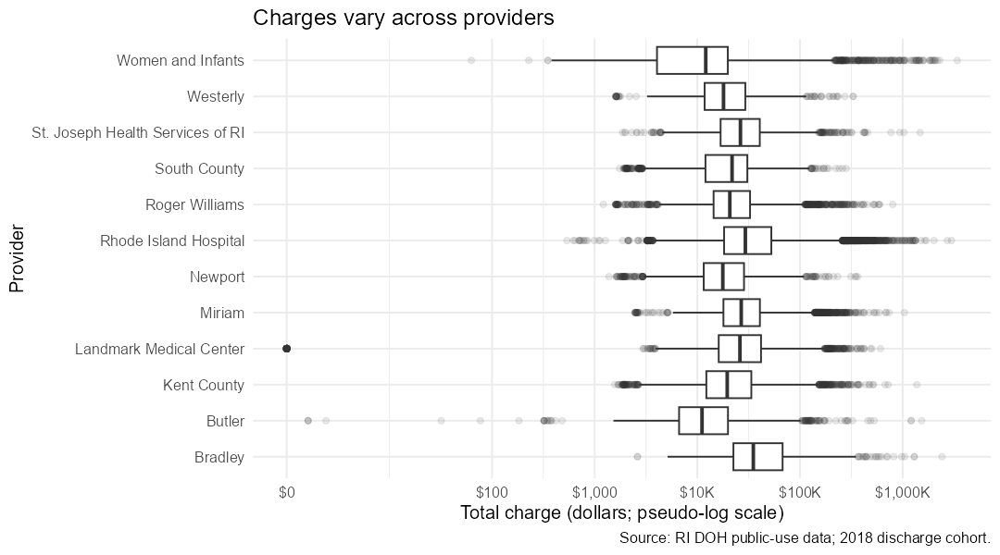

The boxes compare typical charges and their spread across hospitals. Some hospitals also have very expensive stays outside the boxes. Hospitals provide different services and treat different cases. This chart alone cannot tell us which hospital provides better care.

9 / 22
</section>
<section class="slide with-plot" aria-label="Length of stay by season" data-slide="10"><h2>Length of stay by season</h2>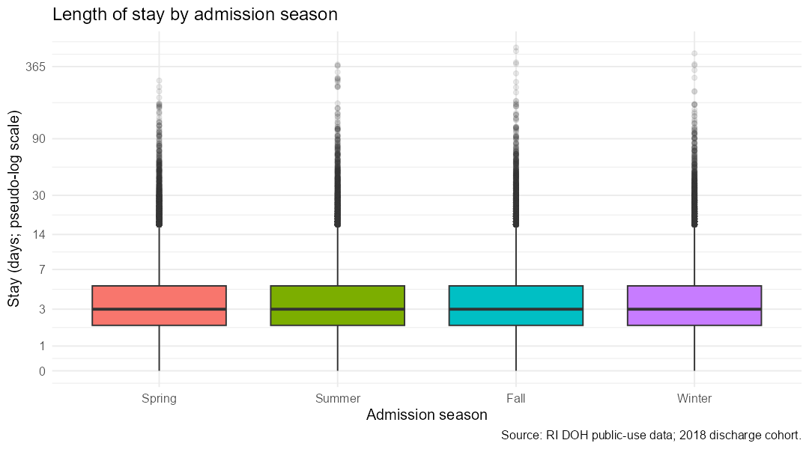

I based seasons on admission month. Average stays ranged from about 4.84 to 4.96 days. Summer had the highest average, but the seasonal differences were small. Each season also included a small number of much longer stays.

10 / 22
</section>
<section class="slide with-plot" aria-label="Average age by month" data-slide="11"><h2>Average age by month</h2>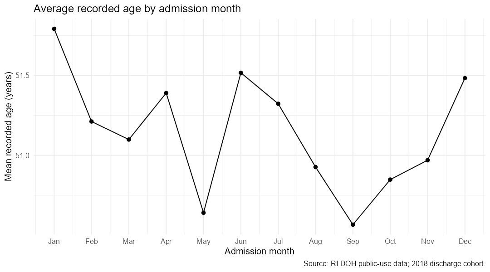

Average recorded age was highest in January, at about 51.79 years. It was lowest in September, at about 50.57 years. The total difference was only about 1.23 years. The monthly averages were fairly similar.

11 / 22
</section>
<section class="slide with-plot" aria-label="Length of stay and charges" data-slide="12"><h2>Length of stay and charges</h2>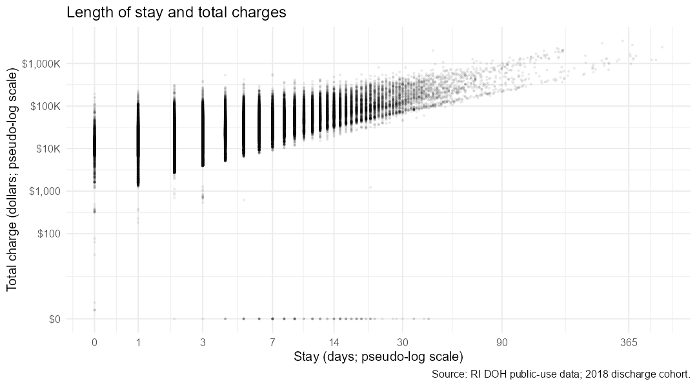

Longer stays generally had higher charges. The correlation was about 0.79, which shows a strong positive relationship. Charges still varied among stays of similar length. This relationship does not prove that one extra day causes a fixed increase in charges.

12 / 22
</section>
<section class="slide with-plot" aria-label="Animation of monthly hospital counts" data-slide="13"><h2>Animation of monthly hospital counts</h2>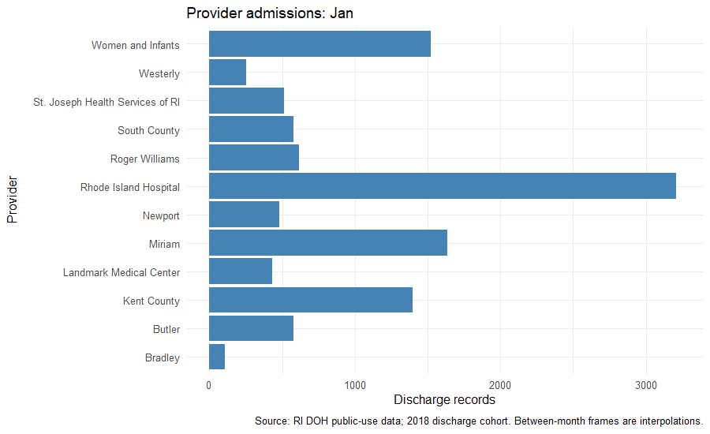

This animation compares hospital counts across admission months. The same scale makes the months easier to compare. The changing bars show how hospital volume varies during the year. The frames between months are visual transitions, not extra observations.

13 / 22
</section>
<section class="slide" aria-label="Predicting low or high charges" data-slide="14"><h2>Predicting low or high charges</h2>

I labeled a stay low if its charge was below $21,854. I labeled it high if its charge was equal to or above that amount.

I used age, sex, race or ethnicity, hospital, admission month, discharge month, admission type, campus, and length of stay.

I used 10% of records for training and 90% for testing after removing blank race and admission-type values. Because the inputs include length of stay, this model uses information available after the stay.

14 / 22
</section>
<section class="slide results" aria-label="Comparing the charge models" data-slide="15"><h2>Comparing the charge models</h2><table aria-label="Comparing the charge models"><tr><th>Model</th><th>Average validation accuracy</th></tr><tr><td>Decision tree</td><td>80.64%</td></tr><tr><td>Random forest</td><td>84.01%</td></tr></table>

I compared a decision tree with a random forest. A random forest combines the predictions of many trees.

I used the same five training folds for both models. Random forest had the higher average validation accuracy, so I selected it before checking the test results.

15 / 22
</section>
<section class="slide results" aria-label="Testing the charge model" data-slide="16"><h2>Testing the charge model</h2><table aria-label="Testing the charge model"><tr><th>Result</th><th>Value</th></tr><tr><td>Random forest</td><td>83.63%</td></tr><tr><td>Always guess the most common class</td><td>50.64%</td></tr></table>

The selected random forest correctly classified about 84 out of 100 test records.

Always guessing the most common charge group would correctly classify about 51 out of 100. The model improved substantially on that simple comparison.

16 / 22
</section>
<section class="slide" aria-label="A second target: longer stays" data-slide="17"><h2>A second target: longer stays</h2>

For my second task, I predicted whether a hospital stay lasted more than seven days. Seven days or less counted as a short stay.

I used age, sex, race or ethnicity, hospital, admission month, admission type, and campus.

I excluded length of stay, discharge month, and charges from the inputs. I repeated the 10% training split and the same five-fold comparison of tree and forest models.

17 / 22
</section>
<section class="slide results" aria-label="Comparing the long-stay models" data-slide="18"><h2>Comparing the long-stay models</h2><table aria-label="Comparing the long-stay models"><tr><th>Model</th><th>Average validation accuracy</th></tr><tr><td>Decision tree</td><td>85.86%</td></tr><tr><td>Random forest</td><td>85.97%</td></tr></table>

Random forest had a slightly higher average validation accuracy, so I selected it for the second task too.

The difference between the models was very small. This result gave me a reason to examine the test results more carefully.

18 / 22
</section>
<section class="slide results four-rows" aria-label="The long-stay model has a weakness" data-slide="19"><h2>The long-stay model has a weakness</h2><table aria-label="The long-stay model has a weakness"><tr><th>Result</th><th>Value</th></tr><tr><td>Overall test accuracy</td><td>85.95%</td></tr><tr><td>Always guess the most common class</td><td>85.26%</td></tr><tr><td>Actual long stays detected</td><td>8.40%</td></tr></table>

The model barely improved on always guessing the most common group. It detected only about 8 out of every 100 actual long stays.

That means it missed most long stays. Its high overall accuracy does not make it a useful tool for identifying longer admissions.

19 / 22
</section>
<section class="slide" aria-label="Coding challenges" data-slide="20"><h2>Coding challenges</h2>

The original file contained more than two million records from 2003 through 2018. Reading the year column first helped me import the relevant records with less memory.

Some R packages were missing when I tried to knit. Those packages need to be installed before the notebook can run.

The animation also had an image-size error. Setting its dimensions to pixels fixed that problem.

20 / 22
</section>
<section class="slide" aria-label="Limits of the results" data-slide="21"><h2>Limits of the results</h2>

The codebook says ages 90 and older are grouped, but the file contains ages up to 110. I kept the recorded ages and noted the mismatch.

The data records billed charges, which can differ from actual costs or payments.

These results describe this discharge group. They do not prove cause and effect or guarantee that a model will work in a future year.

21 / 22
</section>
<section class="slide" aria-label="What I learned" data-slide="22"><h2>What I learned</h2>

Hospital stays and charges vary widely, even within the same hospital. Looking at several charts helped me understand that variation.

Random forest classified charge groups better than the decision tree in this comparison.

The second task showed why accuracy alone can be misleading. I also need to check whether a model finds the outcome I care about.

22 / 22
</section>
</main>
<nav id="controls" aria-label="Presentation controls"><button id="prev" aria-label="Previous slide">Previous</button><button id="next" aria-label="Next slide">Next</button><button id="full">Full screen</button></nav>

