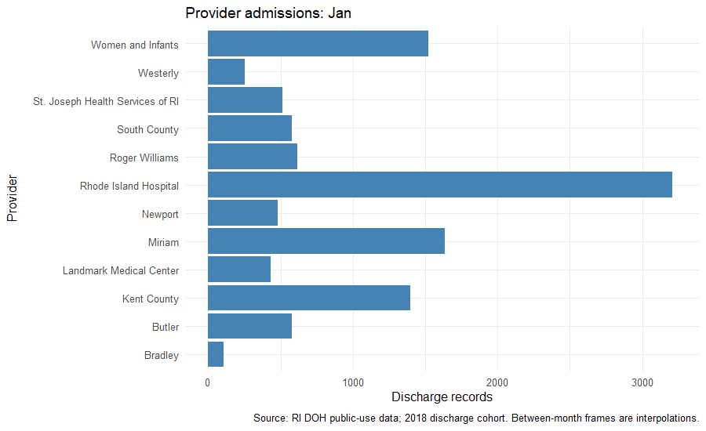

```{r setup, include=FALSE}
knitr::opts_chunk$set(echo=TRUE, message=FALSE, warning=FALSE,
                      fig.width=9, fig.height=5)
# These paths use the libraries available on this computer. When moving the
# notebook, install its packages in your normal R library instead.
extra_libs <- c("../work/r-library", "C:/Users/student/AppData/Local/R/win-library/4.5")
.libPaths(c(extra_libs[dir.exists(extra_libs)], .libPaths()))
library(haven)
library(dplyr)
library(tidyr)
library(ggplot2)
library(caret)
library(rpart)
library(rpart.plot)
library(ranger)
library(gganimate)
library(gifski)
library(knitr)
set.seed(421)
dir.create("midterm_assets", showWarnings=FALSE)
money <- function(x) paste0("$", format(round(x,2), big.mark=",", nsmall=2))
show_table <- function(x) knitr::kable(x, digits=2)
```

This analysis uses Rhode Island Department of Health public-use hospital
discharge records. A record represents a discharge/stay; it does not establish
a unique person across repeated stays. The cohort is selected by **discharge
year**, so some admissions may precede 2018. Category definitions come from
[the 2015–2018 codebook](https://drive.google.com/file/d/1xh_2YQ4Op1izUHRIgrTPyDXk-8TEavw-/view).
Charges are billed amounts, not measured costs or insurance payments.

## I. Data wrangling

### Questions 1–4: read the SAS file, filter 2018, and select variables

```{r import}
required_vars <- c(
 "yod","payfix","pay_ub92","age","sex","raceethn","provider","moa",
 "yoa","mod","admtype","asource","preopday","los","service","icu",
 "ccu","dispub92","payer","drg","trandb","randbg","randbs","orr",
 "anes","seq","lab","dtest","ther","blood","phar","other","patcon",
 "bwght","total","tot","ecodub92","b_wt","pt_state","diag_adm",
 "ancilar","campus","er_fee","er_chrg","er_mode","obs_chrg",
 "obs_hour","psycchrg","nicu_day")

# Read the year column first. If the requested records are contiguous,
# read just that block and the assigned columns; otherwise read the assigned
# columns for the full file. This avoids loading millions of unused rows.
year_index <- haven::read_sas(params$data_file,col_select="yod")
rows_2018 <- which(year_index$yod==18)
stopifnot(length(rows_2018)>0)
if (all(diff(rows_2018)==1)) {
 raw_data <- haven::read_sas(params$data_file,skip=min(rows_2018)-1,
   n_max=length(rows_2018),col_select=all_of(required_vars))
} else {
 raw_data <- haven::read_sas(params$data_file,col_select=all_of(required_vars))
}
rm(year_index,rows_2018)
df_2018 <- raw_data %>% filter(yod == 18) %>% select(all_of(required_vars))
rm(raw_data)
stopifnot(nrow(df_2018)>0)
dim(df_2018)
str(df_2018)
```

### Questions 5–6: identify missing values and remove affected variables

```{r missing-values}
missing_report <- data.frame(variable=names(df_2018),
                             missing=unname(colSums(is.na(df_2018))))
missing_report <- missing_report %>% mutate(percent=100*missing/nrow(df_2018))
show_table(filter(missing_report, missing>0))
removed_vars <- missing_report$variable[missing_report$missing>0]
df <- df_2018 %>% select(-all_of(removed_vars))
stopifnot(!anyNA(df))

# Character blanks are distinct from NA in the imported SAS data.
blank_counts <- vapply(df, function(x) {
  if (is.character(x)) sum(trimws(x)=="") else 0L
}, integer(1))
show_table(data.frame(variable=names(blank_counts)[blank_counts>0],
                      blanks=unname(blank_counts[blank_counts>0])))
```

The 2018 subset contains `r format(nrow(df),big.mark=",")` records.
The NA rule removes `r length(removed_vars)` columns:
`r paste(removed_vars, collapse=", ")`. This follows the assignment's column
removal requirement. Character blanks are reported separately and blank race
and admission-type records are removed for modeling as explicitly requested.
Unknown category codes such as race code 9 remain explicit categories.

### Question 7: admission and discharge month

The codebook defines **moa** as month of admission and **mod** as month of
discharge. Both use month numbers 1–12. Sex is a character code: 1 is male
and 2 is female. Age is recorded at admission. The codebook says ages 90+
are grouped, but the actual file contains ages through 110. I retain the
recorded ages rather than imposing an undocumented recoding; this mismatch
is a limitation of interpreting age statistics.

```{r definitions}
provider_names <- c(
 "7201"="Newport", "7202"="St. Joseph Health Services of RI",
 "7203"="Memorial", "7204"="Miriam", "7205"="Rhode Island Hospital",
 "7206"="Roger Williams", "7209"="South County", "7210"="Kent County",
 "7211"="Westerly", "7212"="Rehab of RI", "7213"="Landmark Medical Center",
 "7214"="Women and Infants", "7215"="Bradley", "7216"="Butler")
df <- df %>% mutate(
 sex=trimws(as.character(sex)),
 provider_name=unname(provider_names[as.character(provider)]),
 admission_month=factor(moa, levels=1:12, labels=month.abb),
 sex_label=factor(sex, levels=c("1","2"), labels=c("Male","Female")),
 season=case_when(moa %in% 3:5 ~ "Spring", moa %in% 6:8 ~ "Summer",
                  moa %in% 9:11 ~ "Fall", moa %in% c(12,1,2) ~ "Winter"),
 season=factor(season, levels=c("Spring","Summer","Fall","Winter")))
stopifnot(!anyNA(df$provider_name), !anyNA(df$season))
```

Seasons use **admission month** and meteorological boundaries. Teenagers are
ages 13–19 inclusive. Every ranking below preserves ties.

### Question 8: months with the most admissions and male admissions

```{r q8}
admissions <- df %>% count(moa, admission_month, name="admissions")
male_admissions <- df %>% filter(sex=="1") %>%
  count(moa, admission_month, name="male_admissions")
show_table(admissions %>% slice_max(admissions, n=1))
show_table(male_admissions %>% slice_max(male_admissions, n=1))
```

These are counts among the 2018 discharge cohort, grouped by admission
month, rather than a complete census of all admissions occurring in 2018.

### Question 9: month with the most teenage female records

```{r q9}
teen_female <- df %>% filter(sex=="2", age>=13, age<=19) %>%
  count(moa, admission_month, name="teen_female_records")
show_table(teen_female %>% slice_max(teen_female_records, n=1))
```

### Question 10: provider with the most female admissions in October

```{r q10}
female_oct <- df %>% filter(sex=="2", moa==10) %>%
  count(provider, provider_name, name="female_records")
show_table(female_oct %>% slice_max(female_records, n=1))
```

### Question 11: mean age by sex

```{r q11}
age_sex <- df %>% filter(sex %in% c("1","2")) %>% group_by(sex_label) %>%
  summarise(n=n(), mean_age=mean(age), .groups="drop")
show_table(age_sex)
age_difference <- age_sex$mean_age[age_sex$sex_label=="Female"] -
                  age_sex$mean_age[age_sex$sex_label=="Male"]
```

Female mean recorded age minus male mean recorded age is
`r round(age_difference,2)` years. Female records are therefore
`r if (age_difference>0) "older" else "younger"` on average in this cohort.
This is a descriptive comparison; differences in provider and service mix
can contribute. The codebook's age-grouping statement disagrees with the
observed values, so these are averages of the recorded ages.

### Question 12: average age by admission month

```{r q12}
age_month <- df %>% group_by(moa, admission_month) %>%
  summarise(n=n(), mean_age=mean(age), .groups="drop")
show_table(age_month)
show_table(age_month %>% slice_max(mean_age,n=1))
```

### Question 13: provider with the highest total charge

I interpret this as **summed charges across all records for a provider**.
For clarity, I also show the provider with the largest individual charge.

```{r q13}
provider_charge <- df %>% group_by(provider, provider_name) %>%
  summarise(n=n(), summed_charges=sum(tot), mean_charge=mean(tot),
            .groups="drop")
show_table(provider_charge %>% slice_max(summed_charges,n=1))
show_table(df %>% slice_max(tot,n=1) %>% select(provider_name,tot))
```

### Question 14: lowest average charge for teenage males

```{r q14}
teen_male_charge <- df %>% filter(sex=="1", age>=13, age<=19) %>%
  group_by(provider, provider_name) %>%
  summarise(n=n(), mean_charge=mean(tot), .groups="drop")
show_table(teen_male_charge %>% slice_min(mean_charge,n=1))
```

Providers with no teenage male records are not assigned a zero average.
The subgroup count helps assess how stable each average may be.

### Question 15: length of stay by season

```{r q15}
season_stay <- df %>% group_by(season) %>%
  summarise(n=n(), mean_los=mean(los), median_los=median(los),.groups="drop")
show_table(season_stay)
show_table(season_stay %>% slice_max(mean_los,n=1))
```

### Question 16: charge for a 20-year-old male staying one day in Fall

The literal interpretation is the average **total charge among one-day
stays** for this subgroup. It is not an estimate of an incremental day of care.

```{r q16}
one_day_fall <- df %>% filter(age==20, sex=="1", season=="Fall",los==1) %>%
  summarise(n=n(), mean_charge=if(n()>0) mean(tot) else NA_real_)
show_table(one_day_fall)
# Alternative daily-rate interpretation, explicitly distinguished:
daily_fall <- df %>% filter(age==20, sex=="1",season=="Fall",los>0) %>%
  summarise(n=n(), mean_individual_daily_charge=mean(tot/los),
            charge_per_total_day=sum(tot)/sum(los))
show_table(daily_fall)
```

### Question 17: wrangling summary

The analysis retained `r format(nrow(df),big.mark=",")` discharge records
after restricting to 2018 and removing columns with NA values. Recorded
mean age differs between female and male records by
`r round(abs(age_difference),2)` years. The highest aggregate provider
charge is `r money(max(provider_charge$summed_charges))`, recorded by
`r paste(provider_charge$provider_name[provider_charge$summed_charges==max(provider_charge$summed_charges)],collapse=", ")`.
The longest average stay occurs in
`r paste(as.character(season_stay$season[season_stay$mean_los==max(season_stay$mean_los)]),collapse=", ")`.
These results describe utilization and billing in the discharge cohort;
they do not establish that sex, season, or provider causes a difference.
Aggregate charges also depend on record volume and case mix.

## II. Visualization

Each figure has a title, caption, and labeled axes. Numeric charge axes
are dollars and stay axes are days. Extreme observations remain in the data.

```{r plot-definitions}
caption_text <- "Source: RI DOH public-use data; 2018 discharge cohort."
theme_set(theme_minimal(base_size=12))
plots <- list(
 monthly = ggplot(admissions,aes(admission_month,admissions)) +
  geom_col(fill="steelblue") + labs(title="Admissions by month",x="Admission month",
   y="Discharge records",caption=caption_text),
 monthly_sex = df %>% filter(!is.na(sex_label)) %>% count(admission_month,sex_label) %>%
  ggplot(aes(admission_month,n,fill=sex_label)) + geom_col(position="dodge") +
  labs(title="Monthly admissions by sex",x="Admission month",y="Discharge records",
       fill="Sex",caption=caption_text),
 age = ggplot(df,aes(age)) + geom_histogram(binwidth=5,fill="steelblue",color="white") +
  labs(title="Recorded age at admission",x="Recorded age (years)",y="Discharge records",
       caption=paste(caption_text,"Recorded ages retained; codebook grouping differs.")),
 age_sex = df %>% filter(!is.na(sex_label)) %>% ggplot(aes(sex_label,age,fill=sex_label)) +
  geom_boxplot(show.legend=FALSE) + labs(title="Age by sex",x="Sex",y="Recorded age (years)",
  caption=caption_text),
 provider = df %>% count(provider_name) %>% ggplot(aes(reorder(provider_name,n),n)) +
  geom_col(fill="steelblue") + coord_flip() + labs(title="Records by provider",
  x="Provider",y="Discharge records",caption=caption_text),
 charges = ggplot(df,aes(tot)) + geom_histogram(bins=50,fill="steelblue",color="white") +
  scale_x_continuous(trans=scales::pseudo_log_trans(base=10),
   breaks=c(0,100,1000,10000,100000,1000000),labels=scales::label_dollar(scale_cut=scales::cut_short_scale())) +
  labs(title="Distribution of total charges",x="Total charge (dollars; pseudo-log scale)",
  y="Discharge records",caption=paste(caption_text,"Pseudo-log includes zero charges.")),
 charge_provider = ggplot(df,aes(provider_name,tot)) + geom_boxplot(outlier.alpha=.1) +
  scale_y_continuous(trans=scales::pseudo_log_trans(base=10),
   breaks=c(0,100,1000,10000,100000,1000000),labels=scales::label_dollar(scale_cut=scales::cut_short_scale())) +
  coord_flip() + labs(title="Charges vary across providers",x="Provider",
  y="Total charge (dollars; pseudo-log scale)",caption=caption_text),
 season = ggplot(df,aes(season,los,fill=season)) + geom_boxplot(show.legend=FALSE,outlier.alpha=.1) +
  scale_y_continuous(trans=scales::pseudo_log_trans(base=10),breaks=c(0,1,3,7,14,30,90,365)) +
  labs(title="Length of stay by admission season",x="Admission season",
  y="Stay (days; pseudo-log scale)",caption=caption_text),
 stay_charge = ggplot(df,aes(los,tot)) + geom_point(alpha=.06,size=.5) +
  scale_x_continuous(trans=scales::pseudo_log_trans(base=10),breaks=c(0,1,3,7,14,30,90,365)) +
  scale_y_continuous(trans=scales::pseudo_log_trans(base=10),
   breaks=c(0,100,1000,10000,100000,1000000),labels=scales::label_dollar(scale_cut=scales::cut_short_scale())) +
  labs(title="Length of stay and total charges",x="Stay (days; pseudo-log scale)",
  y="Total charge (dollars; pseudo-log scale)",caption=caption_text),
 age_month = ggplot(age_month,aes(moa,mean_age)) + geom_line() + geom_point(size=2) +
  scale_x_continuous(breaks=1:12,labels=month.abb) + labs(title="Average recorded age by admission month",
  x="Admission month",y="Mean recorded age (years)",caption=caption_text)
)
for (nm in names(plots)) ggsave(file.path("midterm_assets",paste0(nm,".png")),
                               plots[[nm]],width=9,height=5,dpi=120)
```

### 1. Monthly counts
```{r plot1}
plots$monthly
```
The highest count is `r max(admissions$admissions)` in
`r paste(as.character(admissions$admission_month[admissions$admissions==max(admissions$admissions)]),collapse=", ")`.
These are counts, not rates adjusted for the number of days in a month.

### 2. Monthly counts by sex
```{r plot2}
plots$monthly_sex
```
There are `r sum(df$sex=="2")` female and `r sum(df$sex=="1")` male records.
The grouped bars show whether the difference persists across admission months.
They reflect hospital utilization rather than sex-specific population risk.

### 3. Age histogram
```{r plot3}
plots$age
```
Median recorded age is `r median(df$age)` years. The youngest ages include
newborn care. Recorded ages reach `r max(df$age)`, despite the codebook's
statement about grouping ages 90+; the plot retains those recorded values.

### 4. Age by sex
```{r plot4}
plots$age_sex
```
The boxes compare medians and spread, complementing the mean difference
of `r round(age_difference,2)` years in Part I. A mean alone does not
describe the full distribution or account for different service mixes.

### 5. Provider volume
```{r plot5}
plots$provider
```
`r (df %>% count(provider_name,sort=TRUE))$provider_name[1]` has the most
records. Provider volume is important context for interpreting aggregate charges.

### 6. Total charge histogram
```{r plot6}
plots$charges
```
Mean charges are `r money(mean(df$tot))`, versus a median of
`r money(median(df$tot))`. Their difference measures the influence of the
upper tail. Pseudo-log scaling makes a wide range of values visible.

### 7. Charges by provider
```{r plot7}
plots$charge_provider
```
The lowest and highest provider mean charges are
`r money(min(provider_charge$mean_charge))` and
`r money(max(provider_charge$mean_charge))`. Differences may reflect case
mix, specialties, and length of stay, rather than price alone.

### 8. Length of stay by season
```{r plot8}
plots$season
```
Seasonal mean stays range from `r round(min(season_stay$mean_los),2)` to
`r round(max(season_stay$mean_los),2)` days. The boxplots also show how
within-season variability compares with these differences in means.

### 9. Length of stay versus charge
```{r plot9}
plots$stay_charge
```
The Pearson correlation is `r round(cor(df$los,df$tot),3)` on the original
scales. The association is descriptive, and charge variation at similar
stays can reflect different services and conditions.

### 10. Mean age by admission month
```{r plot10}
plots$age_month
```
Monthly means range from `r round(min(age_month$mean_age),2)` to
`r round(max(age_month$mean_age),2)` recorded years. The axis displays
actual means; it does not imply changes for the same patients over time.

### Animation: provider volume across admission months
```{r animation}
animation_data <- df %>% count(moa,provider_name) %>%
  complete(moa=1:12,provider_name,fill=list(n=0)) %>%
  mutate(month=factor(moa,levels=1:12,labels=month.abb))
animated_plot <- ggplot(animation_data,aes(provider_name,n,group=provider_name)) +
  geom_col(fill="steelblue") + coord_flip() +
  labs(title="Provider admissions: {closest_state}",x="Provider",y="Discharge records",
       caption=paste(caption_text,"Between-month frames are interpolations.")) +
  transition_states(month,transition_length=1,state_length=2,wrap=FALSE)
animation <- animate(animated_plot,nframes=96,fps=8,width=900,height=550,units="px",res=96,
                     renderer=gifski_renderer())
anim_save("midterm_assets/provider_month.gif",animation=animation)

```

The animation compares monthly provider counts on a fixed scale. Intermediate
frames are visual transitions and should not be interpreted as observed days.

### Visualization summary

The figures describe monthly volume, age, provider mix, stay duration, and
charges. Mean charge is `r money(mean(df$tot))`, while median charge is
`r money(median(df$tot))`; reporting both helps describe the distribution.
Provider counts and charge distributions should be considered together.
The stay–charge relationship motivates retrospective classification, but
neither these plots nor the models establish causal effects.

## III. Predictive modeling

### Question 1: charge target, types, and 10:90 split

```{r modeling-data}
inputs <- c("age","sex","raceethn","provider","moa","mod","admtype","campus","los")
stopifnot(all(c(inputs,"tot") %in% names(df)))
# Follow the assignment: define the median on the cleaned Part I cohort,
# before filtering blank race/admission-type records.
charge_median <- median(df$tot)
model_base <- df %>% mutate(target=ifelse(tot<charge_median,"low","high")) %>%
  filter(trimws(as.character(raceethn))!="", trimws(as.character(admtype))!="")
categorical <- c("sex","raceethn","provider","moa","mod","admtype","campus")
model_data <- model_base %>% select(all_of(inputs),target) %>%
  mutate(across(all_of(categorical), ~factor(trimws(as.character(.x)))),
         across(c(age,los),as.numeric),target=factor(target,levels=c("low","high")))
stopifnot(!anyNA(model_data))
set.seed(421)
split_index <- createDataPartition(model_data$target,p=.10,list=FALSE)
train_data <- model_data[split_index,]
test_data <- model_data[-split_index,]
show_table(data.frame(set=c("Training","Testing"),n=c(nrow(train_data),nrow(test_data))))
show_table(as.data.frame(table(model_data$target)))
```

The charge threshold is `r money(charge_median)`. Equality goes to high.
The assigned inputs include discharge month and realized stay duration;
therefore, this is **retrospective charge classification**, not a prediction
available at admission. Charge amounts themselves are excluded as predictors.

### Question 2: initial decision tree and ranked importance

```{r initial-tree}
tree <- rpart(target~.,data=train_data,method="class",
              control=rpart.control(maxdepth=3))
rpart.plot(tree,main="Charge classification: initial decision tree")
importance <- sort(tree$variable.importance,decreasing=TRUE)
if (length(importance)>0) {
 barplot(importance,las=2,cex.names=.8,main="Tree variable importance (ranked)",
         ylab="Importance")
} else {
 plot.new(); title("Tree made no splits; no ranked importance available")
}
```

Importance describes predictive use in this tree and does not measure causation.

### Questions 3–5: tune, compare, select, and test

Both models use the **same five training folds**. Tree depth and random-forest
parameters are tuned using training cross-validation. The held-out test set is
used only after selection. A small explicit grid keeps runtime manageable.

```{r fit-function}
fit_and_compare <- function(training,testing,seed) {
 set.seed(seed)
 folds <- createFolds(training$target,k=5,returnTrain=TRUE)
 ctrl <- trainControl(method="cv",number=5,index=folds,allowParallel=FALSE)
 set.seed(seed)
 tuned_tree <- train(target~.,data=training,method="rpart2",metric="Accuracy",
                     trControl=ctrl,tuneGrid=expand.grid(maxdepth=2:6))
 set.seed(seed)
 tuned_forest <- train(target~.,data=training,method="ranger",metric="Accuracy",
   trControl=ctrl,num.trees=300,num.threads=2,
   tuneGrid=expand.grid(mtry=c(2,4,8),splitrule="gini",min.node.size=c(5,20)))
 models <- list(Tree=tuned_tree,Forest=tuned_forest)
 comparison <- resamples(models)
 # Each caret object selects its best setting using mean CV accuracy.
 scores <- vapply(models,function(m) max(m$results$Accuracy,na.rm=TRUE),numeric(1))
 stopifnot(all(is.finite(scores)), all(vapply(models,function(m)
    nrow(m$resample)==5 && all(is.finite(m$resample$Accuracy)),logical(1))))
 selected <- names(which.max(scores))
 final_model <- models[[selected]]
 prediction <- predict(final_model,newdata=testing)
 cm <- confusionMatrix(prediction,testing$target,positive=levels(testing$target)[2])
 list(models=models,comparison=comparison,scores=scores,selected=selected,
      final_model=final_model,cm=cm)
}
```

```{r charge-models, cache=TRUE}
charge_results <- fit_and_compare(train_data,test_data,421)
```

```{r charge-comparison}
plot(charge_results$models$Tree,main="Tree depth tuning: charge target")
plot(charge_results$models$Forest,main="Forest tuning: charge target")
bwplot(charge_results$comparison,metric="Accuracy")
show_table(data.frame(model=names(charge_results$scores),
                     mean_cv_accuracy=unname(charge_results$scores)))
charge_results$final_model$bestTune
charge_results$cm
png("midterm_assets/charge_model_comparison.png",width=1000,height=600)
print(bwplot(charge_results$comparison,metric="Accuracy"))
dev.off()
```

The selected charge model is **`r charge_results$selected`**, chosen by the
largest mean cross-validation accuracy. Its held-out accuracy is
**`r round(100*charge_results$cm$overall["Accuracy"],2)`%**, compared with a
majority-class baseline of
`r round(100*charge_results$cm$overall["AccuracyNull"],2)`%.
Sensitivity for high charges is
`r round(charge_results$cm$byClass["Sensitivity"],3)` and specificity is
`r round(charge_results$cm$byClass["Specificity"],3)`.

### Question 6: second target, a stay longer than seven days

The second binary outcome is **long** when `los > 7` and **short** otherwise.
Its inputs are age, sex, race/ethnicity, provider, admission month, admission
type, and campus. Length of stay, discharge month, charges, and the first
target are excluded. This avoids directly feeding the answer into the model.

```{r second-target}
second_inputs <- c("age","sex","raceethn","provider","moa","admtype","campus")
second_data <- model_base %>% select(all_of(second_inputs),los) %>%
 mutate(target=factor(ifelse(los>7,"long","short"),levels=c("short","long"))) %>%
 select(-los) %>%
 mutate(across(all_of(setdiff(second_inputs,"age")),~factor(trimws(as.character(.x)))),
        age=as.numeric(age))
stopifnot(!anyNA(second_data))
set.seed(422)
second_split <- createDataPartition(second_data$target,p=.10,list=FALSE)
second_train <- second_data[second_split,]
second_test <- second_data[-second_split,]
show_table(as.data.frame(table(second_data$target)))
show_table(data.frame(set=c("Training","Testing"),n=c(nrow(second_train),nrow(second_test))))
second_tree <- rpart(target~.,data=second_train,method="class",
                     control=rpart.control(maxdepth=3))
rpart.plot(second_tree,main="Initial tree: stay longer than seven days")
second_importance <- sort(second_tree$variable.importance,decreasing=TRUE)
if (length(second_importance)>0) barplot(second_importance,las=2,cex.names=.8,
 main="Ranked importance: long-stay tree",ylab="Importance")
```

```{r stay-models, cache=TRUE}
stay_results <- fit_and_compare(second_train,second_test,422)
```

```{r stay-comparison}
plot(stay_results$models$Tree,main="Tree depth tuning: long-stay target")
plot(stay_results$models$Forest,main="Forest tuning: long-stay target")
bwplot(stay_results$comparison,metric="Accuracy")
show_table(data.frame(model=names(stay_results$scores),
                     mean_cv_accuracy=unname(stay_results$scores)))
stay_results$final_model$bestTune
stay_results$cm
png("midterm_assets/stay_model_comparison.png",width=1000,height=600)
print(bwplot(stay_results$comparison,metric="Accuracy"))
dev.off()
```

The selected long-stay model is **`r stay_results$selected`**. Held-out
accuracy is **`r round(100*stay_results$cm$overall["Accuracy"],2)`%**, versus
the majority-class baseline of
`r round(100*stay_results$cm$overall["AccuracyNull"],2)`%.
Long-stay sensitivity is `r round(stay_results$cm$byClass["Sensitivity"],3)`;
specificity is `r round(stay_results$cm$byClass["Specificity"],3)`; balanced
accuracy is `r round(stay_results$cm$byClass["Balanced Accuracy"],3)`.
These are important alongside accuracy because the classes may be imbalanced.

The model misses approximately
`r round(100*(1-stay_results$cm$byClass["Sensitivity"]),2)`% of actual long
stays. With sensitivity this low, the selected model is a poor tool for
identifying long stays, even though its overall accuracy looks high.
Improving long-stay detection would require a new training-only analysis of
class imbalance, model settings, and an appropriate selection metric, followed
by evaluation on new held-out data. This test set should not be reused for tuning.

### Question 7: modeling summary and limitations

Two different caret methods were tuned for each outcome using five-fold
cross-validation within the assigned 10% training subset. Charge classification
selected `r charge_results$selected`, while long-stay classification selected
`r stay_results$selected`. Test performance is reported against majority-class
baselines, with sensitivity and specificity showing which outcomes are harder
to detect. These are descriptive predictive models, not causal models.
Repeated stays may belong to the same people; without person identifiers we
cannot guarantee patient-independent train/test sets. A random split within
2018 also does not establish performance in a future year or another state.

## Challenges, reproducibility, and presentation notes

- The source file spans 2003–2018. Reading its year index first and importing
  only the relevant block saves memory without sampling the analysis data.
- SAS character blanks and NA values require separate checks. No values were
  imputed in place of the assignment's column-removal rule.
- Numeric category codes were converted to factors for modeling. The specified
  10:90 split replaces the 70:30 demonstration split in the lecture slides.
- The models share saved training folds. Test results did not determine which
  model or tuning parameter was selected.
- Pseudo-log plot scales show both zero and very large values. They change the
  display, not the charge or stay values used in the calculations.
- Model chunks are cached. Delete this notebook's cache folder to force a
  complete refit after changing data or preprocessing. Check all results before
  presenting them, and explain choices in your own words.

```{r save-summary, include=FALSE}
report_summary <- list(n=nrow(df),age_difference=age_difference,
  charge_median=charge_median,charge_model=charge_results$selected,
  charge_accuracy=unname(charge_results$cm$overall["Accuracy"]),
  charge_baseline=unname(charge_results$cm$overall["AccuracyNull"]),
  charge_cv=charge_results$scores,
  stay_model=stay_results$selected,
  stay_accuracy=unname(stay_results$cm$overall["Accuracy"]),
  stay_baseline=unname(stay_results$cm$overall["AccuracyNull"]),
  stay_cv=stay_results$scores,
  stay_sensitivity=unname(stay_results$cm$byClass["Sensitivity"]))
saveRDS(report_summary,"midterm_assets/report_summary.rds")
```

```{r session-info}
sessionInfo()
```
